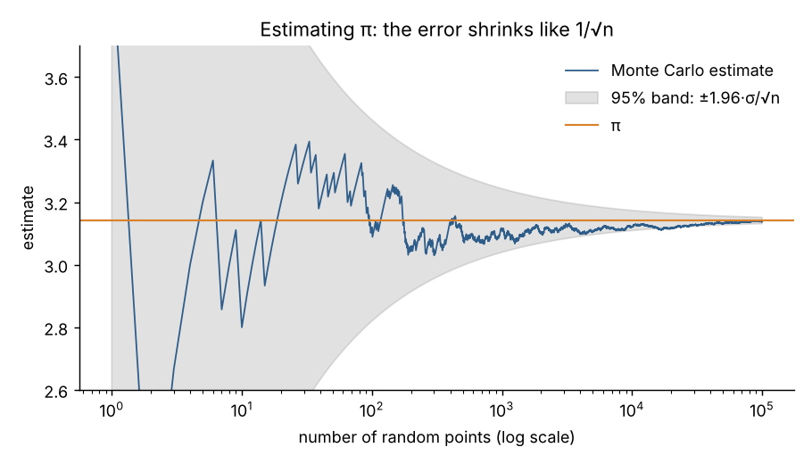
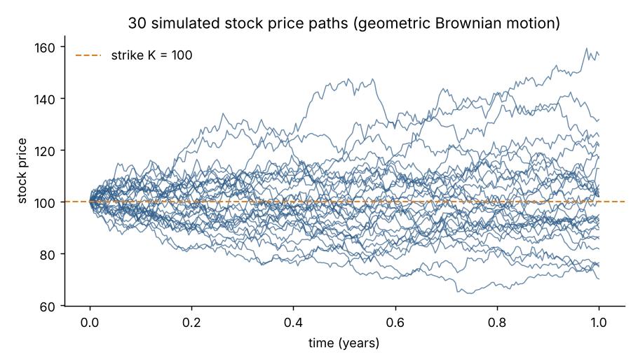
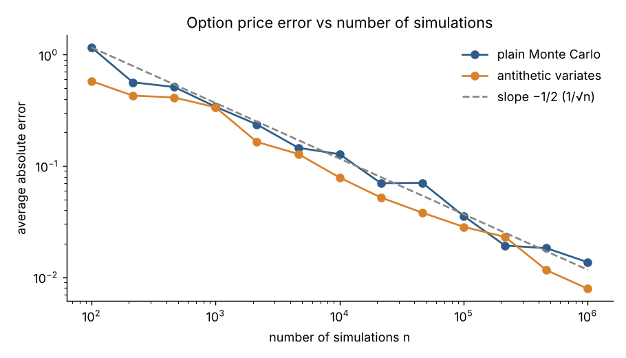

# Monte Carlo Lab: from π to option pricing

How do you compute something you can't calculate exactly? **Simulate it many times and take the average.** This project uses Monte Carlo methods to estimate π and to price a stock option, checks the results against exact formulas, and measures how fast the error shrinks.

Everything is written in plain Python and NumPy, with tests.

## 1. Estimating π with random points

Throw random points into a 1×1 square. The fraction that lands inside the quarter circle x² + y² ≤ 1 is close to π/4, so 4 × (fraction inside) estimates π.



| Points | Estimate | 95% confidence interval |
| --- | --- | --- |
| 1,000 | 3.14800 | [3.04644, 3.24956] |
| 100,000 | 3.13704 | [3.12684, 3.14724] |
| 10,000,000 | 3.14137 | [3.14035, 3.14239] |

**Key idea.** By the central limit theorem, the error of a Monte Carlo average is about 1.96 · σ/√n with 95% confidence. The error shrinks like **1/√n**: to gain one correct digit, you need 100 times more points.

## 2. Pricing a stock option

A European **call option** gives the right to buy a stock at a fixed price K (the strike) at a future date T. It pays max(S_T − K, 0).

In the Black–Scholes model, the stock price follows a geometric Brownian motion:

```
S_T = S_0 · exp((r − σ²/2) · T + σ · √T · Z),   Z ~ N(0, 1)
```



The fair price of the option is the discounted average payoff, e^(−rT) · E[max(S_T − K, 0)]. Monte Carlo simulates many values of Z and averages the payoffs. Black–Scholes gives the exact price, so we can measure the error.

For S₀ = 100, K = 100, r = 3%, σ = 20%, T = 1 year, the exact Black–Scholes price is **9.41340**. With 1,000,000 simulations, Monte Carlo gives **9.41959**, with a 95% interval of [9.39194, 9.44723] that contains the exact price.



**Variance reduction.** With *antithetic variates*, each random draw Z is paired with −Z. The two payoffs are negatively correlated, so their average varies less. In this experiment it cuts the error by about **1.4×** for the same number of simulations, while keeping the same 1/√n slope.

## Usage

```bash
pip install -r requirements.txt
python run.py        # prints all results and saves the figures
python -m pytest     # runs the tests
```

Results are reproducible: `run.py` uses a fixed random seed (42).

## Project structure

```
montecarlo/core.py      sample mean, standard error and 95% confidence interval
montecarlo/pi.py        estimating π
montecarlo/options.py   Black–Scholes formula, stock price simulation, Monte Carlo pricing
run.py                  runs the experiments and draws the figures
tests/                  checks against known values and exact formulas
```

## What the tests check

- The Black–Scholes formula against a textbook value (S₀ = K = 100, r = 5%, σ = 20%, T = 1 → 10.4506).
- The Monte Carlo price is within 4 standard errors of the exact price.
- The π estimate's confidence interval contains π.
- Antithetic variates give a smaller standard error than plain Monte Carlo.

## Next steps

- Price options with no closed-form formula (Asian or barrier options), where Monte Carlo is the main tool.
- Add control variates, another variance-reduction method.
- Estimate the option's sensitivity to the stock price (delta).
